# Security Toolkit

An [XrmToolBox](https://www.xrmtoolbox.com/) tool for Dataverse / Dynamics 365 security administration: see who
has which security roles and teams, compare users, find which roles grant a privilege, spot forgotten users,
roles and teams, and change security safely, with every change reviewed first and undoable.

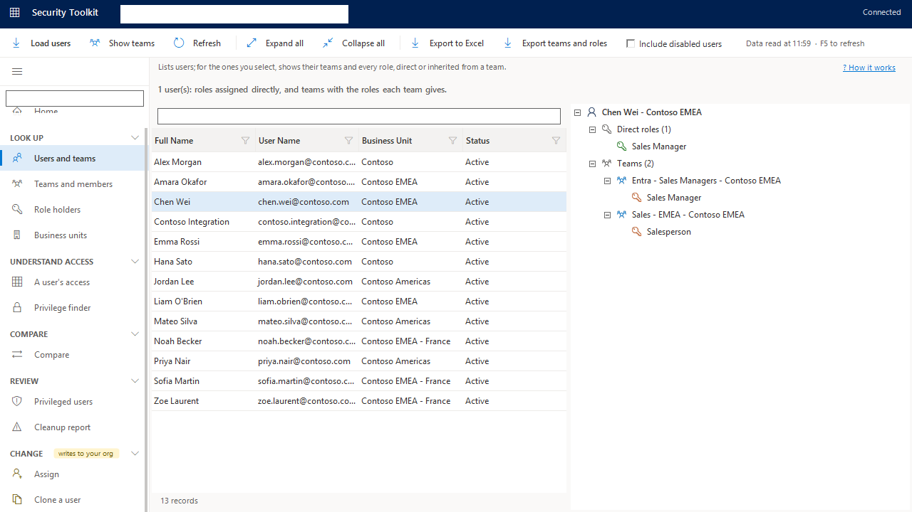

*Screenshots use a fictional demo organization.*

## Features

The menu on the left is grouped by what you want to do: **Look up**, **Understand access**, **Compare** and **Review** only read, and **Change** modifies security and is marked so (and tinted amber). The groups fold, and a "Find a screen" box filters the menu as you type.

- **Users and teams** – pick users and see a tree of their direct roles and their teams, with the roles each
  team gives them. Green keys are assigned directly, orange keys are inherited from a team.
- **Teams and members, Role holders** – pick teams to see their members, or roles to see who holds them: a Users tab (directly or through a team) and a Teams tab (the teams that hold the role, with their member counts), each with its count in the tab title.
- **Business units** – the business-unit hierarchy as a tree, each unit with how many users and teams it holds
  (and how many including its children). Select a unit and choose what to list: its users with their teams and
  roles, its teams, or the security roles in use there. Include child units, and export the list or the users in
  detail.
- **Application users** – the app registrations acting in Dataverse, listed apart from people, with every role
  they hold directly or through a team.
- **Compare** – one screen, three tabs:
  - *How do two users differ?* – pick two users and see the differences side by side: business unit, security
    roles (however each user has them) and teams.
  - *How do two roles differ?* – pick two security roles and see, table by table and privilege by privilege,
    what only one of them grants and where one reaches further.
  - *How do two environments differ?* – Dev against Prod, through a second XrmToolBox connection: the roles only
    one side has, the privileges that differ for the roles both have, and the team roles that differ. Roles,
    teams, tables and privileges are matched by name, so they line up even where their ids differ.
- **Privilege finder** – pick tables, one, several or all privileges (Create, Read, Write, Delete, Append,
  Append To, Assign, Share) and a minimum depth, and see which roles grant them, with one depth column per privilege.
  Switch to the other privileges (Export to Excel, Bulk Delete, Act on Behalf of Another User...) to find the roles
  that grant those.
- **Column security** – who can read or update secured columns. By profile: its secured columns, and who holds
  it (teams, their members, and users directly). By user: every secured column their profiles open, and which
  profile gives each right.
- **A user's access** – one screen, three tabs, and the selected user follows you from tab to tab:
  - *What they can do* – every table against the eight privileges, each cell showing how far the user's roles
    reach (own records, business unit, parent and child units, or the whole organization), drawn with the same
    icons and wording as the Dynamics 365 security role editor.
  - *Why they have access* – "why can this user delete accounts?" Pick users, a privilege and a table, and see
    every route to it: which role, whether the user holds it directly or through which team, and how far it
    reaches, with the strongest route marked.
  - *Access to a record* – "can this user (or team) open this record?" Pick a user or team and a record (paste
    its link or id, or search by name) and see, for Read, Write, Delete, Append, Append To, Assign and Share,
    whether they have it and why: the role that reaches the record, ownership, a share, or what falls short. A
    second tab lists everyone the record is shared with. The answer comes from the platform itself; the reasons
    come from the roles, business units and shares.
- **Privileged users** – a security review in six checks: which roles can delete across the whole organization
  (measured by what the role can do, so it works in any language), who holds them directly or through a team,
  the built-in System Administrators and Customizers, disabled users and service accounts that still hold them,
  and users who have collected eight or more roles.
- **Cleanup report** – seven checks for things that look forgotten or pointless: active users with no role,
  disabled users still in teams or holding roles, roles nobody holds, empty teams, teams that carry no role, and
  roles that add nothing (a role a user holds whose every privilege they already get from their other roles). You
  can act on the findings: take disabled users out of their teams, remove their roles, or remove the roles that
  add nothing, through the same review, restore file and undo as every other change.
- **Assign** – one screen, three tabs: add or remove security roles for users, add or remove them for teams, and
  add users to owner teams or take them out. **Clone a user** copies one user's business unit, roles and teams onto others.
- **See before you change** – the review of every change to roles or team membership has a second tab, "What
  changes for each user": every table privilege each affected user gains or loses, losses first.
- **Safe changes** – every change is listed for review before anything is sent, with notes on what was
  skipped and why. You can save a restore file first, see each change's result, and undo what succeeded. Try
  the Change screens on a development environment first.
- **Rules built in** – a role can only be given as the copy in the user's or team's own business unit, and
  team membership is only changed for plain owner teams (access teams, Entra group teams and default teams are
  managed by Dataverse). Moving a user to another business unit removes all of their roles and cannot be
  undone by the tool, so the review warns about it.
- **Easy to pick up** – the Home page lists the questions you ask ("Why can this user delete accounts?", "Is
  anyone over-privileged?") and opens the screen that answers each one. Every screen says in one line what it
  does, has a "How it works" link with the steps, and tells you what to select while its results area is empty.
- **Go from one screen to the next** – right-click a user, team, role or table in any list (or in the Users and
  teams tree) and open another screen on it, already selected: "What can this user do?", "Why does this user
  have access?", "See who holds this role", "Which roles grant access to this table?" and more. Right-click also
  copies a cell or the selected rows.
- **Search from anywhere** – type part of a name in the search box of the title bar (Ctrl+K) to find any user,
  team, role or table, then pick the screen to open it in. With nothing typed, it lists what you opened lately.
- **Remembers where you were** – the toolkit reopens on the screen you used last in each environment, and keeps
  the options you ticked (Include disabled users, Differences only...). The command bar shows when the data was
  read; F5 refreshes it and Ctrl+E exports to Excel.
- **Find and filter anything** – every list is searchable, sortable by column title, and filterable by value
  from the funnel in each column header. What you see can be exported to Excel: a
  formatted workbook with a frozen, filtered header, coloured depths, and an About sheet saying what was exported,
  from which environment and when.
- **Stays in your environment** – it runs on your XrmToolBox connection, reads security records (users, roles,
  teams, business units, and for the Privilege finder the tables and role privileges), and sends nothing
  anywhere else.

## Screenshots

**Start from the question you have**

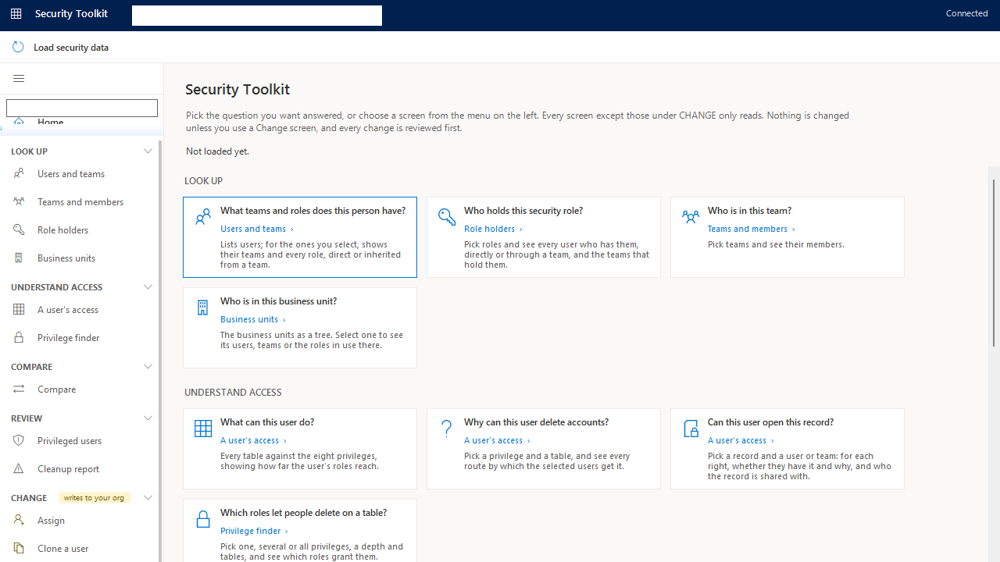

**Compare two users**

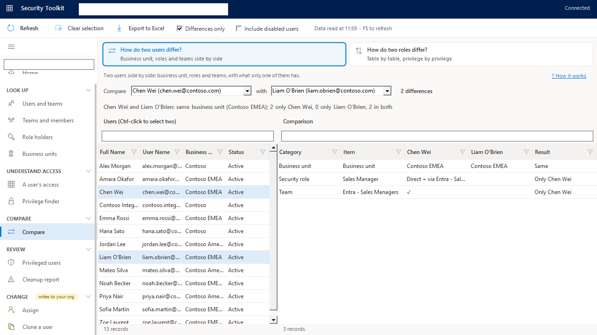

**Browse the business-unit hierarchy**

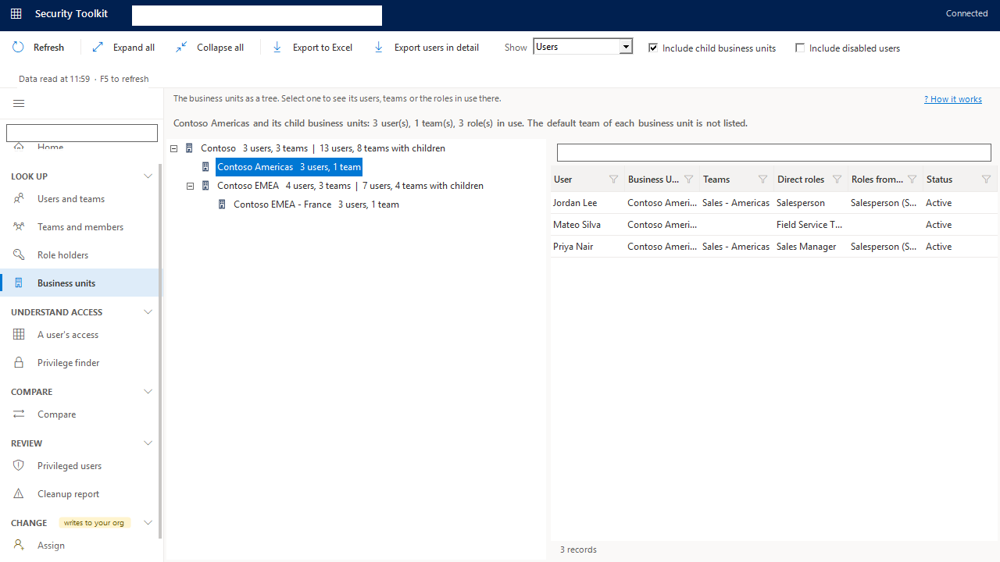

**See who holds a role, and which teams hold it**

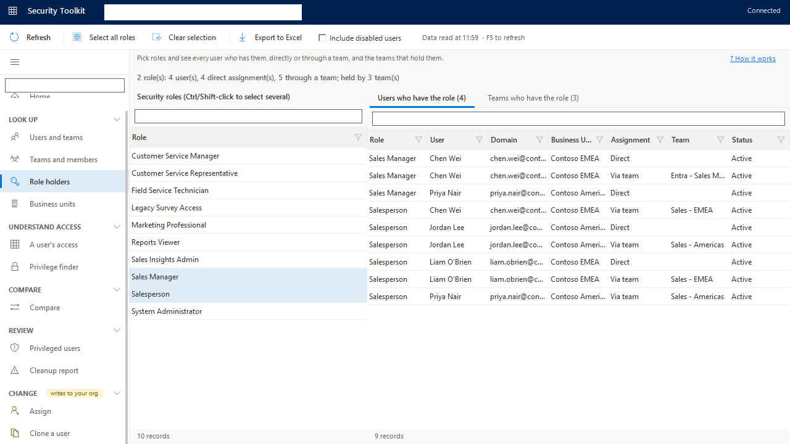

**Compare two security roles**

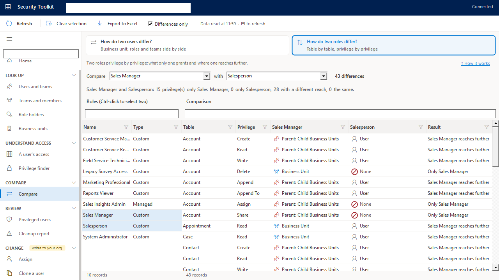

**Find which roles grant a privilege**

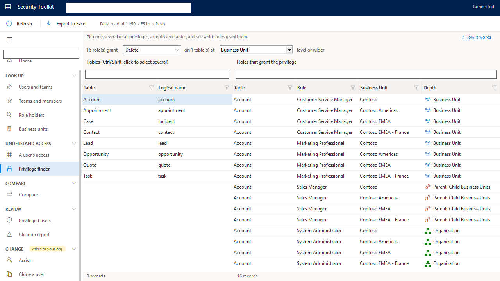

**See why a user has access**

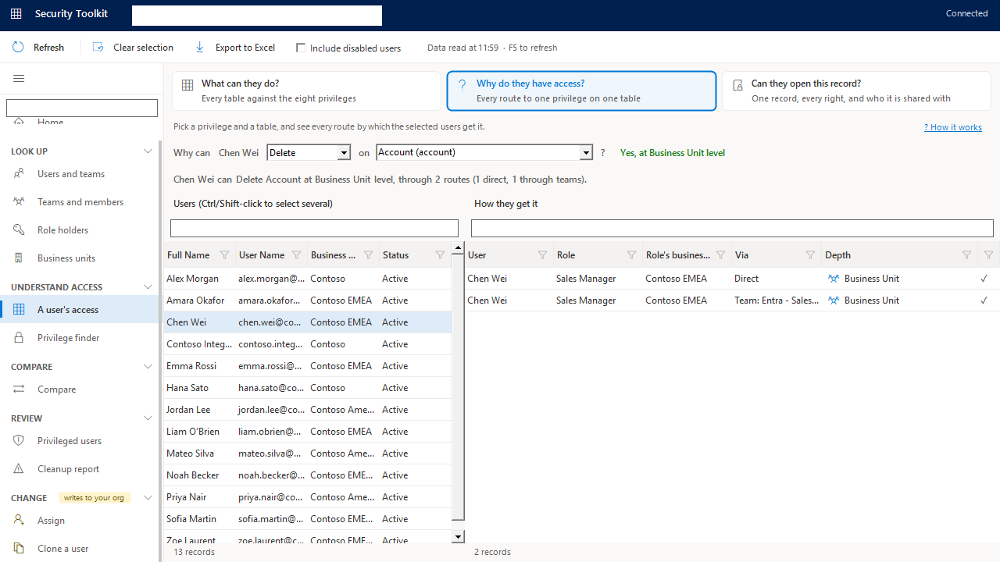

**Check access to one record**

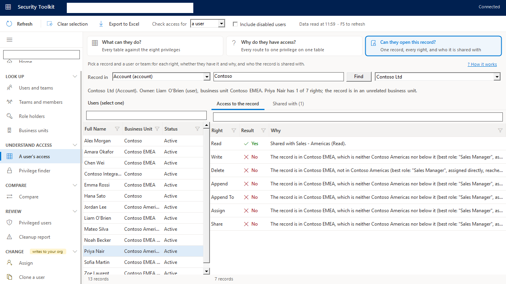

**See everything a user can do**

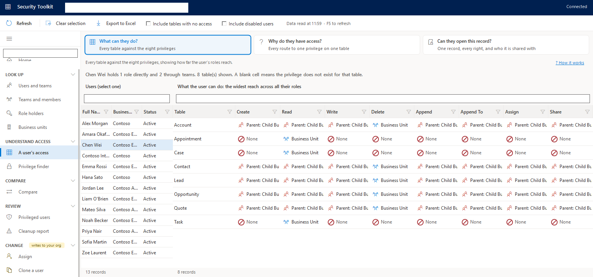

**Review who holds the most powerful roles**

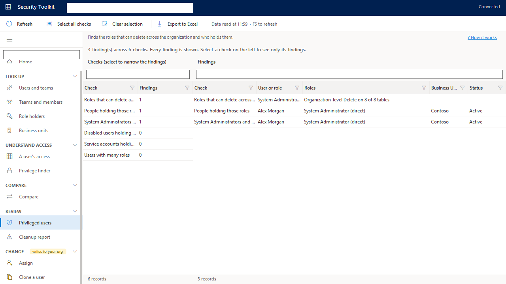

**Spot forgotten users, roles and teams**

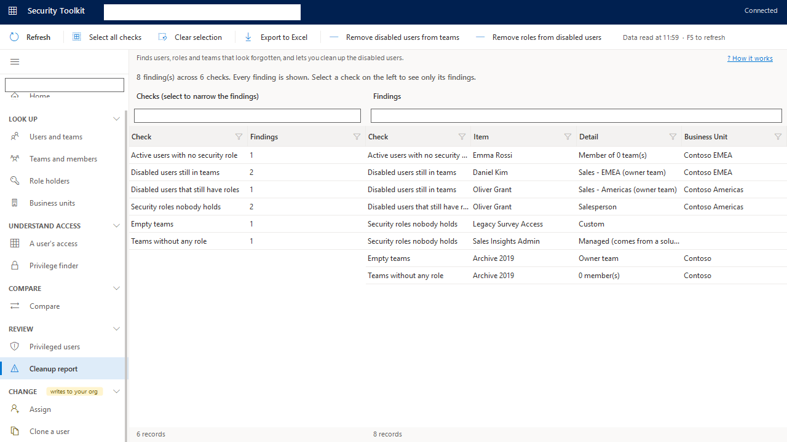

**Assign roles: see who already has each one**

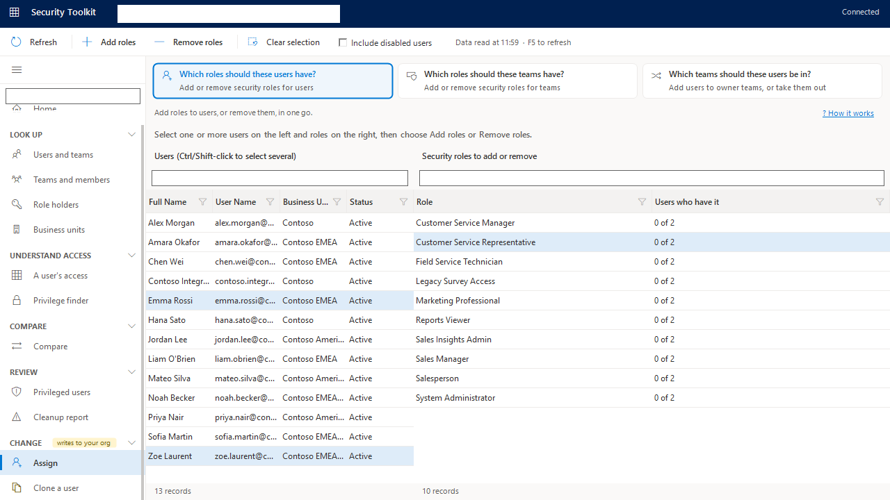

**Review every change before it is applied**

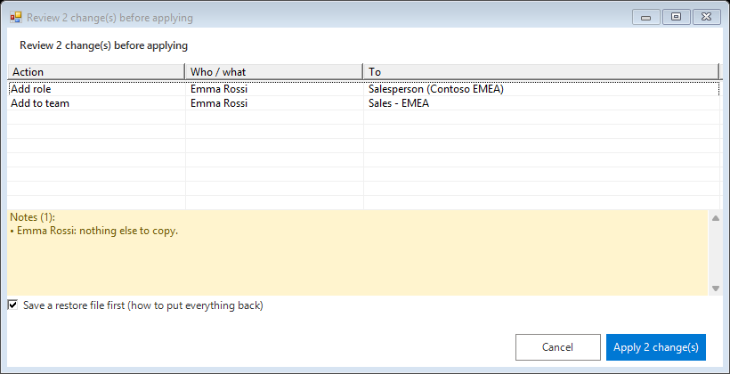

## License

[MIT](https://github.com/abdelkayoumd/SecurityToolkit/blob/main/LICENSE) © 2026 abdelkayoumd
